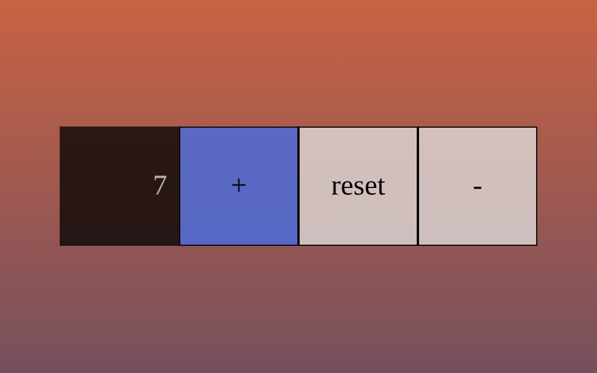

# Contatore

Contatore con tre pulsanti: **+** aumenta il valore, **−** lo diminuisce e **reset** lo riporta a zero. Il valore non può scendere sotto lo zero: se ci provi compare un avviso.

**Provalo online:** [demolitionweb.github.io/Progetto-Javas-TommasoDominici/Index.html](https://demolitionweb.github.io/Progetto-Javas-TommasoDominici/Index.html)

## Tecnologie

- **HTML** e **CSS** per l'interfaccia
- **JavaScript** per aggiornare il valore nella pagina con `textContent`

È uno dei miei primi esercizi in JavaScript. I progetti più recenti sono sul mio [profilo GitHub](https://github.com/DemolitionWeb) e nel [portfolio](https://demolitionweb.github.io/Project/).

## Provarlo in locale

Scarica il repository e apri `Index.html` nel browser.

## Licenza

GPL-3.0, vedi il file [LICENSE](LICENSE).
